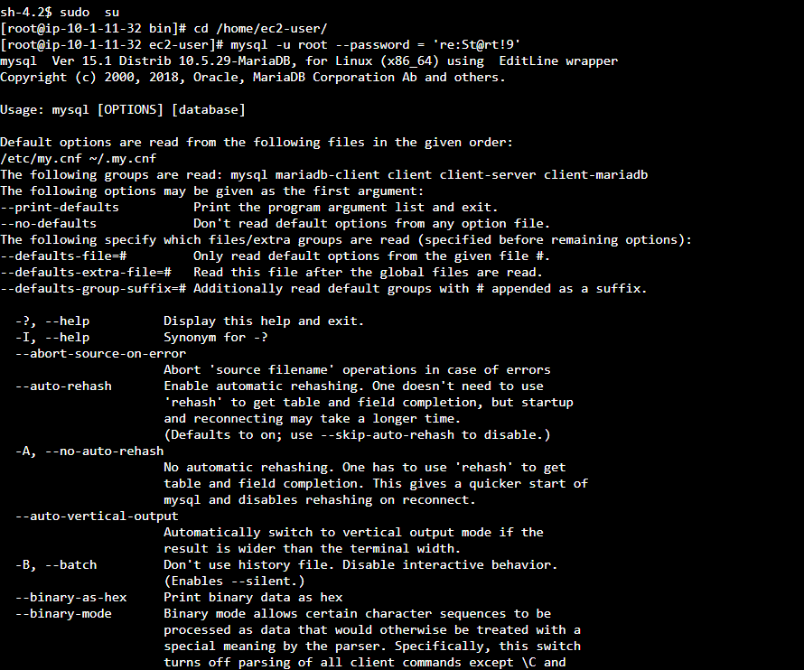
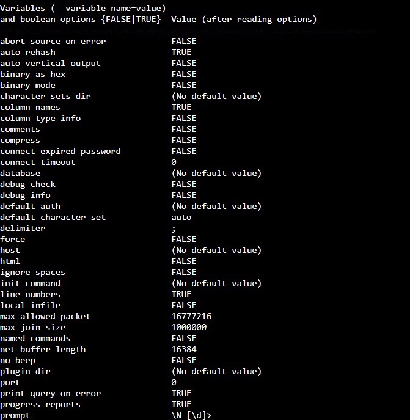
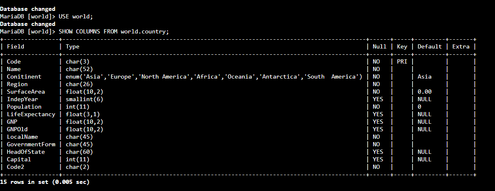
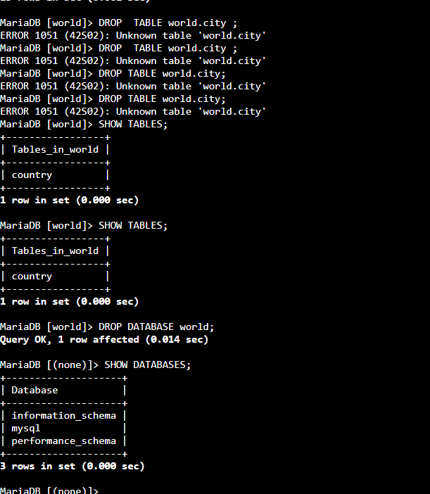

# 🗄️ AWS re/Start — Operações em Bancos de Dados e Tabelas (SQL / MySQL)

Laboratório prático do programa **AWS re/Start** em que, conectado a uma instância de banco de dados relacional **MySQL**, pratiquei as operações mais comuns de **definição de dados**: **criar** (`CREATE`), **listar** (`SHOW`), **alterar** (`ALTER`) e **excluir** (`DROP`) bancos de dados e tabelas.


---

## 🎯 Objetivos do laboratório

- Usar **`CREATE`** para criar bancos de dados e tabelas
- Usar **`SHOW`** para visualizar os bancos e tabelas disponíveis
- Usar **`ALTER`** para alterar a estrutura de uma tabela
- Usar **`DROP`** para excluir bancos de dados e tabelas

## 📩 O cenário

A equipe de operações de banco de dados de uma organização configurou uma instância de banco relacional e pediu para eu **praticar a criação e a exclusão** de bancos de dados e tabelas.

---

## 🧩 O que eu fiz

### Tarefa 1: Conectar ao *Command Host*
1. No **EC2**, selecionei a instância **Command Host** e conectei pelo **Session Manager** (sem SSH)
2. Preparei o terminal:

```bash
sudo su
cd /home/ec2-user/
```

3. Conectei ao MySQL com o cliente de linha de comando:

```bash
mysql -u root --password='<senha-do-banco>'
```

| Opção | Significado |
|---|---|
| `-u` / `--user` | Usuário usado na conexão |
| `-p` / `--password` | Senha do usuário |

> 🔐 **Segurança:** não incluí a senha do lab. Além disso, passar a senha **direto na linha de comando** não é o ideal (ela pode ficar no histórico do terminal). Em ambientes reais, o melhor é usar `-p` **sem valor**, para o MySQL **pedir a senha** de forma oculta.

### Tarefa 2: Criar um banco de dados e uma tabela

**1. Ver os bancos existentes:**
```sql
SHOW DATABASES;
```

**2. Criar o banco `world` e conferir:**
```sql
CREATE DATABASE world;
SHOW DATABASES;
```

**3. Criar a tabela `country`**, definindo o **esquema** (as colunas e seus tipos):

```sql
CREATE TABLE world.country (
  `Code` CHAR(3) NOT NULL DEFAULT '',
  `Name` CHAR(52) NOT NULL DEFAULT '',
  `Conitinent` ENUM('Asia','Europe','North America','Africa','Oceania','Antarctica','South America') NOT NULL DEFAULT 'Asia',
  `Region` CHAR(26) NOT NULL DEFAULT '',
  `SurfaceArea` FLOAT(10,2) NOT NULL DEFAULT '0.00',
  `IndepYear` SMALLINT DEFAULT NULL,
  `Population` INT NOT NULL DEFAULT '0',
  `LifeExpectancy` FLOAT(3,1) DEFAULT NULL,
  `GNP` FLOAT(10,2) DEFAULT NULL,
  `GNPOld` FLOAT(10,2) DEFAULT NULL,
  `LocalName` CHAR(45) NOT NULL DEFAULT '',
  `GovernmentForm` CHAR(45) NOT NULL DEFAULT '',
  `HeadOfState` CHAR(60) DEFAULT NULL,
  `Capital` INT DEFAULT NULL,
  `Code2` CHAR(2) NOT NULL DEFAULT '',
  PRIMARY KEY (`Code`)
);
```

**O que significam os elementos principais:**

| Elemento | Significado |
|---|---|
| `CHAR(n)` | Texto de tamanho **fixo** de até `n` caracteres |
| `ENUM(...)` | A coluna só aceita **um dos valores** da lista |
| `FLOAT(10,2)` | Número decimal (10 dígitos no total, 2 depois da vírgula) |
| `SMALLINT` / `INT` | Números inteiros (pequeno e padrão) |
| `NOT NULL` | **Obrigatório**: não pode ficar vazio |
| `DEFAULT` | Valor usado quando nenhum é informado |
| `PRIMARY KEY (Code)` | Identificador **único** de cada linha da tabela |

**4. Conferir a tabela e suas colunas:**
```sql
USE world;
SHOW TABLES;
SHOW COLUMNS FROM world.country;
```

> O `USE` define **em qual banco** os próximos comandos vão rodar.

**5. Corrigir um erro de digitação com `ALTER TABLE`:**
Ao listar as colunas, notei que a coluna **`Continent`** foi criada com o nome errado (**`Conitinent`**). Corrigi renomeando:

```sql
ALTER TABLE world.country RENAME COLUMN Conitinent TO Continent;
SHOW COLUMNS FROM world.country;
```

### Desafio 1: Criar a tabela `city`
Criar uma tabela `city` com duas colunas, **`Name`** e **`Region`**, ambas do tipo `CHAR`. A minha solução:

```sql
CREATE TABLE world.city (
  Name CHAR(35),
  Region CHAR(26)
);
```

> 💡 No MySQL, `CHAR` **sem tamanho** equivale a `CHAR(1)`, ou seja, só **1 caractere**. Por isso é importante informar o tamanho (por exemplo, `CHAR(35)`).

### Tarefa 3: Excluir tabelas e o banco de dados

```sql
DROP TABLE world.city;        -- exclui a tabela city
```

### Desafio 2: Excluir a tabela `country`
```sql
DROP TABLE world.country;
```

**Conferir e excluir o banco:**
```sql
SHOW TABLES;                  -- confirma que as tabelas sumiram
DROP DATABASE world;          -- exclui o banco de dados
SHOW DATABASES;               -- confirma que o banco foi excluído
```

---

## 🧠 O que eu aprendi

| Comando | Para que serve |
|---|---|
| `CREATE DATABASE` / `CREATE TABLE` | **Criar** bancos e tabelas |
| `SHOW DATABASES` / `SHOW TABLES` / `SHOW COLUMNS` | **Listar** bancos, tabelas e colunas |
| `USE` | **Escolher** o banco em que vou trabalhar |
| `ALTER TABLE` | **Alterar** a estrutura de uma tabela (nome de coluna, por exemplo) |
| `DROP TABLE` / `DROP DATABASE` | **Excluir** tabelas e bancos |

- Uma **tabela precisa de um esquema bem definido**: nome, tipo e regras de cada coluna
- A **chave primária** garante que cada linha seja identificável de forma única
- **Escolher o tipo de dado certo** (`CHAR`, `INT`, `FLOAT`, `ENUM`...) importa para a **qualidade e o tamanho** dos dados
- **Sempre conferir** o resultado com `SHOW`, em vez de presumir que o comando funcionou
- Erros de digitação em nomes de colunas se **corrigem com `ALTER TABLE`**, sem recriar a tabela

> ⚠️ **Cuidado com o `DROP`:** uma tabela ou banco excluído **não pode ser recuperado**, a menos que exista um **backup**. Em produção, é essencial ter backups e confirmar duas vezes **em qual banco** o comando está sendo executado.

## ✅ Boas práticas que levo daqui

- **Praticar em um banco de teste**, nunca direto em produção
- **Conferir o banco atual** antes de executar comandos destrutivos
- **Manter backups** antes de excluir ou alterar estruturas
- **Não deixar senhas** em comandos, scripts ou repositórios
- **Escolher nomes claros** e revisar a grafia ao criar tabelas e colunas
- **Encerrar o laboratório** ao final para liberar os recursos

---

## 📸 Evidências








## 📄 Créditos dos dados

Os dados de exemplo (país, cidade e idioma) vêm do **Statistics Finland** (baixados em 4 de fevereiro de 2022), sob a licença **CC BY 4.0**.

---

## 👤 Autor

**Werther Crisley**
🔗 [GitHub](https://github.com/WertherCrisley)