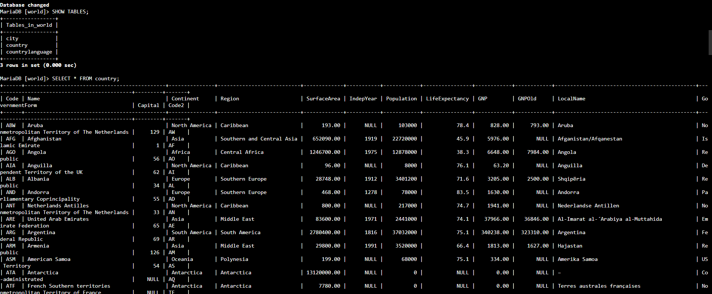

# ✍️ AWS re/Start — Inserindo, Atualizando e Excluindo Dados (SQL / MySQL)

Laboratório prático do programa **AWS re/Start** em que, conectado a um banco de dados relacional **MySQL**, pratiquei a **manipulação de dados** com **`INSERT`**, **`UPDATE`** e **`DELETE`**, e também aprendi a **importar dados em massa** a partir de um arquivo SQL.


---

## 🎯 Objetivos do laboratório

- **Inserir** linhas em uma tabela
- **Atualizar** linhas em uma tabela
- **Excluir** linhas de uma tabela
- **Importar** linhas de um arquivo de backup do banco de dados

## 📩 O cenário

A equipe de operações de banco de dados criou um banco relacional chamado **`world`**, com três tabelas: **`city`**, **`country`** e **`countrylanguage`**. Minha tarefa era **validar a configuração** executando `INSERT`, `UPDATE` e `DELETE` na tabela **`country`**.

---

## 🧩 O que eu fiz

### Tarefa 1: Conectar ao banco
1. Conectei na instância **Command Host** pelo **Session Manager** (sem SSH):

```bash
sudo su
cd /home/ec2-user/
mysql -u root --password='<senha-do-banco>'
```

2. Listei os bancos disponíveis:

```sql
SHOW DATABASES;
```

> 🔐 Não incluí a senha do lab neste README. Em ambientes reais, a senha **não deve ficar na linha de comando**; o ideal é usar `-p` sem valor, para o MySQL pedir a senha de forma oculta.

### Tarefa 2: Inserir dados (`INSERT`)

**Conferir a tabela:**
```sql
SELECT * FROM world.country;
```

- `SELECT` escolhe as **colunas** do resultado (`*` = todas)
- `FROM` indica **de onde** ler (banco e tabela)

**Inserir duas linhas:**
```sql
INSERT INTO world.country VALUES
  ('IRL', 'Ireland', 'Europe', 'British Islands', 70273.00, 1921, 3775100, 76.8, 75921.00, 73132.00, 'Ireland/Éire', 'Republic', 1447, 'IE');

INSERT INTO world.country VALUES
  ('AUS', 'Australia', 'Oceania', 'Australia and New Zealand', 7741220.00, 1901, 18886000, 79.8, 351182.00, 392911.00, 'Australia', 'Constitutional Monarchy, Federation', 135, 'AU');
```

> **Lição:** sem listar as colunas, os valores do `VALUES` precisam estar **na mesma ordem** em que as colunas foram definidas no esquema da tabela.

**Conferir apenas as linhas inseridas:**
```sql
SELECT * FROM world.country WHERE Code IN ('IRL', 'AUS');
```

### Tarefa 3: Atualizar dados (`UPDATE`)

```sql
UPDATE world.country SET Population = 0;
SELECT * FROM world.country;

UPDATE world.country SET Population = 100, SurfaceArea = 100;
SELECT * FROM world.country;
```

- `UPDATE` indica a **tabela**, e `SET` define as **colunas** e os **novos valores**
- Dá para alterar **várias colunas** de uma vez, separando por vírgula

> ⚠️ **Como os comandos não têm `WHERE`, eles atualizaram TODAS as linhas** da tabela. A cláusula **`WHERE`** serve para **filtrar** quais linhas serão afetadas (por exemplo, `WHERE Code = 'IRL'`) e é assunto do próximo laboratório.

### Tarefa 4: Excluir dados (`DELETE`)

```sql
SET FOREIGN_KEY_CHECKS = 0;
DELETE FROM world.country;
SELECT * FROM world.country;
```

- `DELETE FROM` remove **linhas** da tabela (a tabela em si continua existindo)
- Sem `WHERE`, **todas** as linhas foram excluídas
- O `SET FOREIGN_KEY_CHECKS = 0` **desliga temporariamente a verificação de chaves estrangeiras**, que impediria apagar linhas referenciadas por outras tabelas

> 💡 Essa configuração vale para a **sessão atual**. Depois de usar, o ideal é **religar** com `SET FOREIGN_KEY_CHECKS = 1;`, para o banco voltar a proteger a integridade dos dados.

> ⚠️ **Cuidado:** `UPDATE` e `DELETE` podem ser **irreversíveis**. Em produção, sempre use `WHERE`, teste primeiro com um `SELECT` equivalente e tenha **backup**.

### Tarefa 5: Importar dados de um arquivo SQL

**1. Saí do MySQL:**
```sql
QUIT;
```

**2. Conferi se o arquivo existe:**
```bash
ls /home/ec2-user/world.sql
```

**3. Importei o script para o banco:**
```bash
mysql -u root --password='<senha-do-banco>' < /home/ec2-user/world.sql
```

- O **`<`** (redirecionamento de entrada) manda o **conteúdo do arquivo** para o MySQL executar
- O script cria as outras duas tabelas e **insere os dados nas três**

**4. Reconectei e verifiquei:**
```sql
USE world;
SHOW TABLES;                 -- city, country e countrylanguage
SELECT * FROM country;       -- agora com muito mais linhas
SELECT * FROM city;
SELECT * FROM countrylanguage;
```

> **Lição:** inserir linha por linha é demorado. Um **script SQL** carrega um grande volume de dados de uma vez, o que também é a base de **restauração de backups**.

---

## 🧠 O que eu aprendi

| Comando | Para que serve | Atenção |
|---|---|---|
| `SELECT` | **Consultar** dados | Use `WHERE` para filtrar |
| `INSERT INTO ... VALUES` | **Adicionar** linhas | Respeitar a ordem e os tipos das colunas |
| `UPDATE ... SET` | **Alterar** valores | **Sem `WHERE`, altera todas as linhas** |
| `DELETE FROM` | **Remover** linhas | **Sem `WHERE`, remove todas as linhas** |
| `mysql ... < arquivo.sql` | **Importar** um script | Confirmar o banco de destino |

- **DDL x DML:** no lab anterior, mexi na **estrutura** (`CREATE`, `ALTER`, `DROP`). Agora, mexi nos **dados** (`INSERT`, `UPDATE`, `DELETE`)
- **`DELETE` x `DROP`:** `DELETE` apaga **linhas** e mantém a tabela, enquanto `DROP` apaga a **tabela inteira**
- **Chaves estrangeiras** protegem a **integridade** entre tabelas relacionadas
- **Conferir sempre** com `SELECT` depois de cada alteração

## ✅ Boas práticas que levo daqui

- **Sempre usar `WHERE`** em `UPDATE` e `DELETE`, a não ser que eu realmente queira afetar tudo
- **Testar com `SELECT` antes** de alterar ou excluir
- **Fazer backup** antes de mudanças em massa
- **Religar as verificações** de chave estrangeira depois de usá-las
- **Não deixar senhas** em comandos ou repositórios
- **Encerrar o laboratório** ao final para liberar os recursos

---

## 📸 Evidências





## 👤 Autor

**Werther Crisley**
🔗 [GitHub](https://github.com/WertherCrisley)