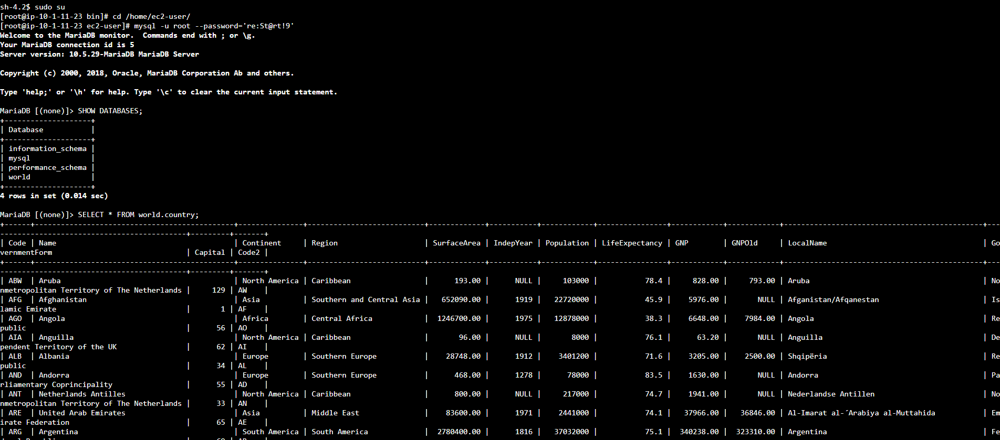

# 🔎 AWS re/Start — Consultando Dados com SELECT (SQL / MySQL)

Laboratório prático do programa **AWS re/Start** em que, conectado a um banco de dados relacional **MySQL** com dados de países, pratiquei **consultas** com a instrução **`SELECT`**, a função **`COUNT()`**, **apelidos de colunas** (`AS`), **ordenação** (`ORDER BY`) e **filtros** (`WHERE`, `AND` e operadores de comparação).


---

## 🎯 Objetivos do laboratório

- Usar **`SELECT`** para consultar um banco de dados
- Usar a função **`COUNT()`**
- Usar os operadores **`<`**, **`>`**, **`=`**, **`WHERE`**, **`ORDER BY`** e **`AND`**

## 📩 O cenário

A equipe de operações criou um banco chamado **`world`**, com as tabelas **`city`**, **`country`** e **`countrylanguage`**. Com base em casos de uso definidos no lab, escrevi consultas usando `SELECT` e operadores.

---

## 🧩 O que eu fiz

### Tarefa 1: Conectar ao banco
Conectei na instância **Command Host** pelo **Session Manager** (sem SSH) e abri o cliente MySQL:

```bash
sudo su
cd /home/ec2-user/
mysql -u root --password='<senha-do-banco>'
```

> 🔐 Não incluí a senha do lab neste README. Em ambientes reais, a senha não deve ficar na linha de comando (o ideal é usar `-p` sem valor, para o MySQL pedir a senha de forma oculta).

### Tarefa 2: Consultar o banco `world`

**1. Confirmar que o banco existe:**
```sql
SHOW DATABASES;
```

**2. Ver todas as linhas e colunas da tabela `country`:**
```sql
SELECT * FROM world.country;
```

**3. Contar as linhas com `COUNT()`:**
```sql
SELECT COUNT(*) FROM world.country;
```

> `COUNT(*)` conta **todas as linhas**. Já `COUNT(coluna)` conta apenas as linhas em que **aquela coluna tem valor** (ignora os `NULL`).

**4. Ver a estrutura da tabela (para saber os nomes das colunas):**
```sql
SHOW COLUMNS FROM world.country;
```

**5. Escolher colunas específicas:**
```sql
SELECT Name, Capital, Region, SurfaceArea, Population FROM world.country;
```

**6. Dar um nome mais amigável a uma coluna com `AS`:**
```sql
SELECT Name, Capital, Region, SurfaceArea AS "Surface Area", Population
FROM world.country;
```

> O `AS` cria um **apelido** só para a saída da consulta, sem alterar a tabela.

**7. Ordenar o resultado com `ORDER BY`:**
```sql
-- crescente (padrão)
SELECT Name, Capital, Region, SurfaceArea AS "Surface Area", Population
FROM world.country
ORDER BY Population;

-- decrescente
SELECT Name, Capital, Region, SurfaceArea AS "Surface Area", Population
FROM world.country
ORDER BY Population DESC;
```

**8. Filtrar com `WHERE` e um operador de comparação:**
```sql
SELECT Name, Capital, Region, SurfaceArea AS "Surface Area", Population
FROM world.country
WHERE Population > 50000000
ORDER BY Population DESC;
```

**9. Combinar condições com `AND`:**
```sql
SELECT Name, Capital, Region, SurfaceArea AS "Surface Area", Population
FROM world.country
WHERE Population > 50000000 AND Population < 100000000
ORDER BY Population DESC;
```

### Desafio: *Qual país do sul da Europa tem mais de 50.000.000 de habitantes?*
A minha solução:

```sql
SELECT Name, Region, Population
FROM world.country
WHERE Region = 'Southern Europe' AND Population > 50000000;
```

> A resposta aparece na saída da consulta. Confira no seu banco, pois depende dos dados carregados.

---

## 🧠 O que eu aprendi

### Anatomia de uma consulta

```sql
SELECT colunas          -- O QUE mostrar
FROM   tabela           -- DE ONDE
WHERE  condição         -- QUAIS linhas (filtro)
ORDER BY coluna [DESC]; -- EM QUE ORDEM
```

### Resumo dos recursos

| Recurso | Para que serve | Exemplo |
|---|---|---|
| `SELECT *` | Todas as colunas | `SELECT * FROM world.country` |
| `SELECT colunas` | Só as colunas escolhidas | `SELECT Name, Population ...` |
| `COUNT(*)` | Contar linhas | `SELECT COUNT(*) ...` |
| `AS` | Apelido para a coluna na saída | `SurfaceArea AS "Surface Area"` |
| `ORDER BY` | Ordenar o resultado | `ORDER BY Population DESC` |
| `WHERE` | Filtrar linhas | `WHERE Population > 50000000` |
| `AND` | **Todas** as condições devem ser verdadeiras | `... > 50000000 AND ... < 100000000` |
| `<` `>` `=` | Comparar valores | `Population > 50000000` |

- **`ORDER BY`** ordena em ordem **crescente** por padrão, e o **`DESC`** inverte
- O **`WHERE`** vem **antes** do `ORDER BY` na consulta
- **Texto** vai entre aspas simples (`'Southern Europe'`), mas **números** não
- Selecionar **só as colunas necessárias** deixa a consulta mais legível e eficiente do que usar `*`
- Conhecer o **esquema** (`SHOW COLUMNS`) antes de consultar evita erros de nome de coluna

## ✅ Boas práticas que levo daqui

- **Verificar a estrutura** da tabela antes de escrever a consulta
- **Evitar `SELECT *`** em tabelas grandes, pedindo só o necessário
- **Usar apelidos** para deixar os resultados mais claros
- **Filtrar e ordenar** para facilitar a leitura e a análise
- **Não deixar senhas** em comandos ou repositórios
- **Encerrar o laboratório** ao final para liberar os recursos

---

## 📸 Evidências





## 👤 Autor

**Werther Crisley**
🔗 [GitHub](https://github.com/WertherCrisley)