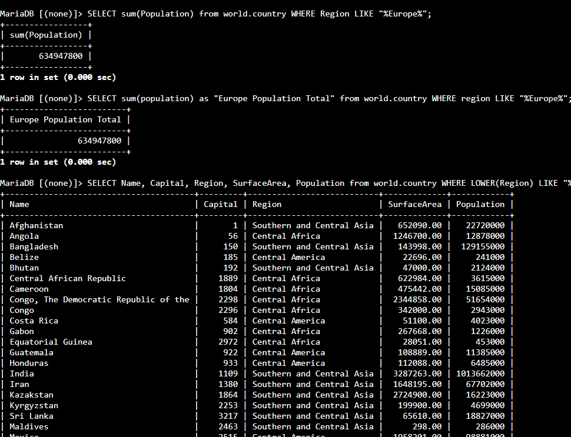
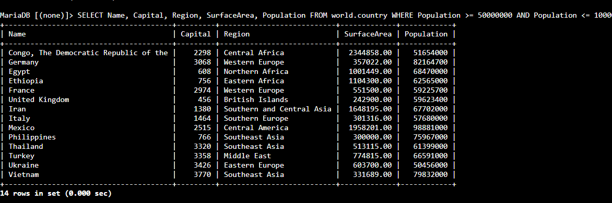
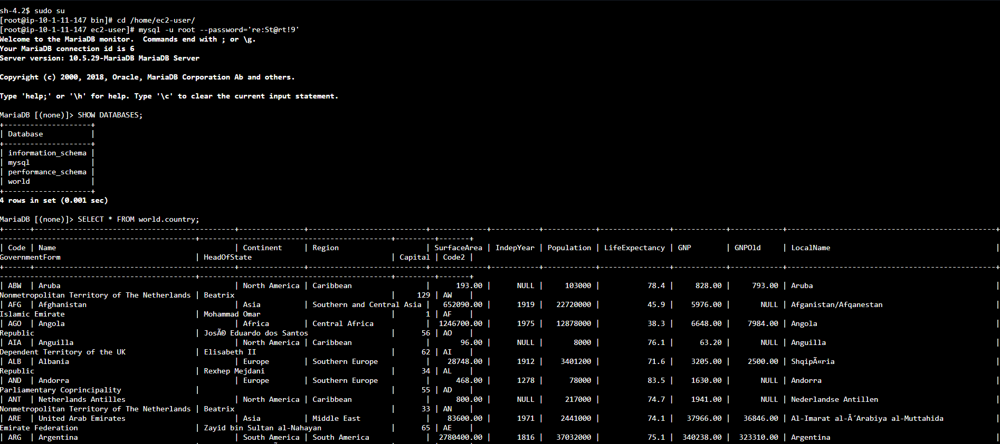

# 🎯 AWS re/Start — Pesquisa Condicional em SQL (`WHERE`, `BETWEEN`, `LIKE`)

Laboratório prático do programa **AWS re/Start** em que, conectado a um banco de dados **MySQL**, aprendi a **filtrar registros** com a cláusula **`WHERE`**, o operador **`BETWEEN`**, o operador **`LIKE`** com **coringas**, além de usar **funções** (`SUM`, `LOWER`) e **apelidos** (`AS`).


---

## 🎯 Objetivos do laboratório

- Escrever uma condição de pesquisa com **`WHERE`**
- Usar o operador **`BETWEEN`**
- Usar o operador **`LIKE`** com **caracteres coringa**
- Usar **`AS`** para criar um **alias** de coluna
- Usar **funções** em um `SELECT` e em um `WHERE`

## 📩 O cenário

A equipe de operações criou o banco **`world`**, com as tabelas **`city`**, **`country`** e **`countrylanguage`**. Para ajudar a equipe, escrevi consultas para **pesquisar registros** na tabela `country` usando `SELECT` e `WHERE`.

---

## 🧩 O que eu fiz

### Tarefa 1: Conectar ao banco
Conectei na instância **Command Host** pelo **Session Manager** (sem SSH):

```bash
sudo su
cd /home/ec2-user/
mysql -u root --password='<senha-do-banco>'
```

> 🔐 Não incluí a senha do lab neste README. Em ambientes reais, evite senha na linha de comando; use `-p` sem valor para o MySQL pedir a senha de forma oculta.

### Tarefa 2: Consultar o banco `world`

**1. Conferir o banco e a tabela:**
```sql
SHOW DATABASES;
SELECT * FROM world.country;
```

**2. Filtrar com `WHERE` e `AND` (faixa de população):**
```sql
SELECT Name, Capital, Region, SurfaceArea, Population
FROM world.country
WHERE Population >= 50000000 AND Population <= 100000000;
```

- Cada registro é testado nas **duas condições**, e só entra no resultado se **ambas** forem verdadeiras
- `>=` significa **maior ou igual**, e `<=`, **menor ou igual**

**3. Fazer a mesma consulta com `BETWEEN`:**
```sql
SELECT Name, Capital, Region, SurfaceArea, Population
FROM world.country
WHERE Population BETWEEN 50000000 AND 100000000;
```

> O `BETWEEN` é **inclusivo** (os valores inicial e final **fazem parte** do resultado) e deixa a consulta **mais fácil de ler** do que `>=` com `<=`.

**4. Procurar texto com `LIKE` e o coringa `%`, somando com `SUM`:**
```sql
SELECT SUM(Population) FROM world.country WHERE Region LIKE '%Europe%';
```

- O **`%`** representa **qualquer quantidade de caracteres** (inclusive nenhum)
- `'%Europe%'` encontra **qualquer região que contenha** "Europe" no nome (como *Southern Europe* e *Eastern Europe*)
- **`SUM()`** soma os valores da coluna das linhas encontradas

**5. Dar um nome legível ao resultado com `AS`:**
```sql
SELECT SUM(Population) AS "Europe Population Total"
FROM world.country
WHERE Region LIKE '%Europe%';
```

**6. Comparar texto sem se preocupar com maiúsculas e minúsculas, usando `LOWER`:**
```sql
SELECT Name, Capital, Region, SurfaceArea, Population
FROM world.country
WHERE LOWER(Region) LIKE '%central%';
```

- **`LOWER()`** converte o texto para **minúsculas**, e assim a comparação funciona mesmo que o texto do banco use outra caixa de letras

> 💡 **Sobre maiúsculas e minúsculas:** o **SQL em si** não diferencia `SELECT` de `select`. Mas o **conteúdo** das colunas pode ser comparado de forma sensível ou não, dependendo do **agrupamento (*collation*)** do banco. Usar `LOWER()` (ou `UPPER()`) dos dois lados é uma forma segura de **ignorar a diferença**. Mesmo assim, é boa prática **escrever os nomes como estão no esquema** (`Population`, e não `population`).

### Desafio: *soma da área de superfície e da população da América do Norte*
A minha solução:

```sql
SELECT SUM(SurfaceArea) AS "Total Surface Area",
       SUM(Population)  AS "Total Population"
FROM world.country
WHERE Continent = 'North America';
```

> Primeiro vi as colunas da tabela (`SHOW COLUMNS FROM world.country;`) para saber qual usar: a de continente (`Continent`), a de área (`SurfaceArea`) e a de população (`Population`). Os valores do resultado dependem dos dados do seu banco.

---

## 🧠 O que eu aprendi

| Recurso | Para que serve | Exemplo |
|---|---|---|
| `WHERE` | **Filtrar** as linhas | `WHERE Population > 50000000` |
| `AND` | **Todas** as condições devem ser verdadeiras | `... >= 50000000 AND ... <= 100000000` |
| `>=` / `<=` | Maior ou igual / menor ou igual | `Population >= 50000000` |
| `BETWEEN` | Valor **dentro de um intervalo** (inclusivo) | `BETWEEN 50000000 AND 100000000` |
| `LIKE` | **Padrão de texto** | `Region LIKE '%Europe%'` |
| `%` | Coringa: **qualquer** quantidade de caracteres | `'%Europe%'`, `'Europe%'`, `'%Europe'` |
| `SUM()` | **Somar** valores | `SUM(Population)` |
| `AS` | **Alias** (apelido) para a coluna | `AS "Europe Population Total"` |
| `LOWER()` | Texto em **minúsculas** | `LOWER(Region)` |

- **Filtrar** deixa o resultado **menor e mais fácil** de analisar
- **Funções** (`SUM`, `LOWER`) podem ser usadas **tanto no `SELECT` quanto no `WHERE`**
- Com **`LIKE`**, a posição do `%` muda a busca: **no início**, **no fim** ou **nos dois lados**
- **Aspas simples** para texto e **sem aspas** para números

## ✅ Boas práticas que levo daqui

- **Escolher o operador mais legível** (`BETWEEN` em vez de `>=` com `<=`)
- **Usar `LOWER`/`UPPER`** quando a caixa das letras puder variar
- **Dar aliases** a resultados calculados
- **Seguir a grafia do esquema** nos nomes de tabelas e colunas
- **Ver a estrutura da tabela** antes de escrever a consulta
- **Encerrar o laboratório** ao final para liberar os recursos

---

## 📸 Evidências







 

## 📄 Créditos dos dados

Os dados de exemplo (país, cidade e idioma) vêm do **Statistics Finland** (baixados em 4 de fevereiro de 2022), sob a licença **Creative Commons Attribution 4.0 (CC BY 4.0)**.

---

## 👤 Autor

**Werther Crisley**
🔗 [GitHub](https://github.com/WertherCrisley)