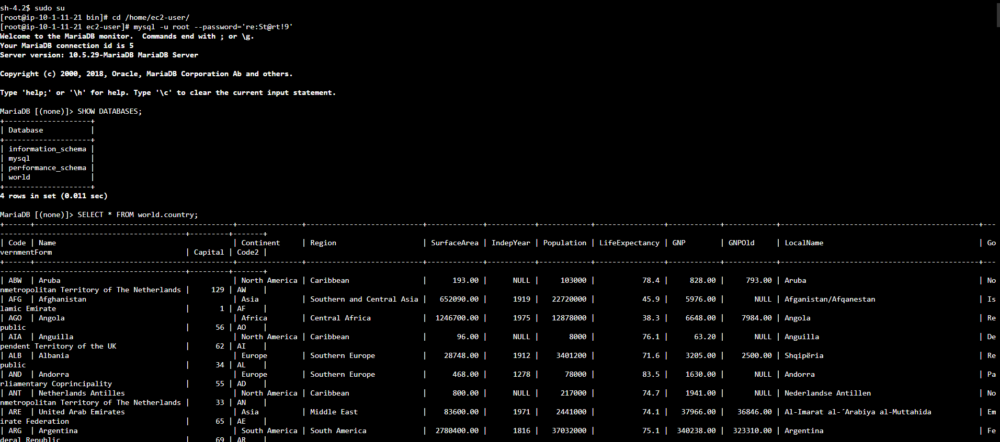
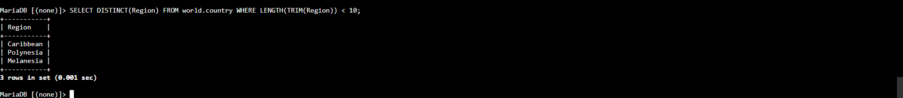

# 🧰 AWS re/Start — Trabalhando com Funções SQL (Agregação e Texto)

Laboratório prático do programa **AWS re/Start** em que, conectado a um banco de dados **MySQL**, usei **funções de agregação** (`SUM`, `AVG`, `MAX`, `MIN`, `COUNT`) para resumir dados e **funções de texto** (`SUBSTRING_INDEX`, `LENGTH`, `TRIM`) e **`DISTINCT`** para manipular e filtrar informações, tanto no `SELECT` quanto no `WHERE`.


---

## 🎯 Objetivos do laboratório

- Usar as funções de agregação **`SUM()`**, **`MIN()`**, **`MAX()`** e **`AVG()`** para resumir dados
- Usar **`SUBSTRING_INDEX()`** para dividir textos
- Usar **`LENGTH()`** e **`TRIM()`** para medir o tamanho de um texto
- Usar **`DISTINCT`** para eliminar registros duplicados
- Usar **funções** no `SELECT` e no `WHERE`

## 📩 O cenário

A equipe de operações criou o banco **`world`**, com as tabelas **`city`**, **`country`** e **`countrylanguage`**. Escrevi consultas usando **funções do banco** com `SELECT` e `WHERE`.

---

## 🧩 O que eu fiz

### Tarefa 1: Conectar ao banco
Conectei na instância **Command Host** pelo **Session Manager** (sem SSH):

```bash
sudo su
cd /home/ec2-user/
mysql -u root --password='<senha-do-banco>'
```

> 🔐 Não incluí a senha do lab neste README. Em ambientes reais, evite senha na linha de comando; use `-p` sem valor para o MySQL pedir a senha de forma oculta.

### Tarefa 2: Consultar o banco `world`

**1. Conferir o banco e a tabela:**
```sql
SHOW DATABASES;
SELECT * FROM world.country;
```

**2. Resumir os dados com funções de agregação:**
```sql
SELECT SUM(Population), AVG(Population), MAX(Population), MIN(Population), COUNT(Population)
FROM world.country;
```

| Função | O que retorna |
|---|---|
| `SUM()` | A **soma** de todos os valores |
| `AVG()` | A **média** dos valores |
| `MAX()` | O **maior** valor |
| `MIN()` | O **menor** valor |
| `COUNT()` | A **quantidade** de linhas que têm valor na coluna |

> Como a consulta **não tem `WHERE`**, as funções consideram **todas as linhas** da tabela.
> 💡 `MAX()` e `MIN()` devolvem o **valor**, e não a linha inteira. Para saber **qual país** tem a maior população, o caminho é usar `ORDER BY Population DESC LIMIT 1`.

**3. Dividir um texto com `SUBSTRING_INDEX()`:**
```sql
SELECT Region, SUBSTRING_INDEX(Region, ' ', 1) FROM world.country;
```

- `SUBSTRING_INDEX(texto, separador, quantidade)` devolve o trecho **antes** da N-ésima ocorrência do separador
- Com `1` e o separador **espaço**, pega a **primeira palavra** da região (por exemplo, "Southern" de "Southern Europe")

**4. Usar a função dentro do `WHERE`:**
```sql
SELECT Name, Region FROM world.country
WHERE SUBSTRING_INDEX(Region, ' ', 1) = 'Southern';
```

Assim, filtrei os países cuja região **começa com "Southern"**.

**5. Medir o tamanho de um texto com `LENGTH()` e `TRIM()`:**
```sql
SELECT Region FROM world.country WHERE LENGTH(TRIM(Region)) < 10;
```

- **`TRIM()`** remove os **espaços** do início e do fim
- **`LENGTH()`** conta o tamanho do que sobrou
- As **funções podem ser combinadas** (aninhadas): primeiro roda a de dentro, depois a de fora

> 💡 O `LENGTH()` do MySQL conta **bytes**. Em textos só com caracteres simples (como aqui), equivale ao número de caracteres. Para contar **caracteres** de verdade, existe o `CHAR_LENGTH()`.

**6. Eliminar duplicados com `DISTINCT`:**
```sql
SELECT DISTINCT(Region) FROM world.country WHERE LENGTH(TRIM(Region)) < 10;
```

A consulta anterior mostrava **regiões repetidas** (vários países na mesma região). O `DISTINCT` deixa **cada valor aparecer uma vez só**.

> 💡 Tecnicamente, `DISTINCT` é uma **palavra-chave**, não uma função, então os parênteses são opcionais: `SELECT DISTINCT Region ...` funciona igual.

### Desafio: *dividir a região `Micronesian/Caribbean` em duas colunas*
Requisito: retornar as linhas cuja região é **`Micronesian/Caribbean`**, com a saída dividida em duas colunas: **`Region Name 1`** e **`Region Name 2`**.

A minha solução:

```sql
SELECT SUBSTRING_INDEX(Region, '/', 1)  AS "Region Name 1",
       SUBSTRING_INDEX(Region, '/', -1) AS "Region Name 2"
FROM world.country
WHERE Region = 'Micronesian/Caribbean';
```

- Com **`1`**, pega o texto **antes** da barra (`Micronesian`)
- Com **`-1`**, pega o texto **depois** da barra (`Caribbean`), pois o número **negativo** conta **a partir do final**
- O **`AS`** dá nome às duas colunas do resultado

---

## 🧠 O que eu aprendi

| Tipo | Função | Para que serve |
|---|---|---|
| **Agregação** | `SUM`, `AVG`, `MAX`, `MIN`, `COUNT` | **Resumir** várias linhas em um valor |
| **Texto** | `SUBSTRING_INDEX` | **Dividir** um texto por um separador |
| **Texto** | `TRIM` | **Remover espaços** nas pontas |
| **Texto** | `LENGTH` | **Medir** o tamanho |
| **Filtro** | `DISTINCT` | **Eliminar duplicados** |

- **Funções** transformam e resumem dados **dentro da própria consulta**, sem precisar de outro programa
- Funções podem ser usadas **no `SELECT`** (para mostrar) e **no `WHERE`** (para filtrar)
- **Funções de agregação** devolvem **uma linha** para o conjunto todo (ou uma por grupo, com `GROUP BY`)
- Dá para **combinar funções** (`LENGTH(TRIM(...))`)
- O **`COUNT(coluna)`** ignora valores `NULL`

> ⚠️ **Desempenho:** usar função sobre uma **coluna** no `WHERE` (como `SUBSTRING_INDEX(Region, ...)`) pode **impedir o uso de índices** e deixar a consulta mais lenta em tabelas grandes. Em tabelas pequenas, como a do lab, não faz diferença.

## ✅ Boas práticas que levo daqui

- **Conferir os dados** (`SELECT *`) antes de aplicar funções
- **Usar `DISTINCT`** para ver valores únicos
- **Dar aliases** (`AS`) a resultados calculados ou transformados
- **Entender o que cada função devolve** (valor x linha, bytes x caracteres)
- **Encerrar o laboratório** ao final para liberar os recursos

---

## 📸 Evidências






## 📄 Créditos dos dados

Os dados de exemplo (país, cidade e idioma) vêm do **Statistics Finland** (baixados em 4 de fevereiro de 2022), sob a licença **CC BY 4.0**.

---

## 👤 Autor

**Werther Crisley**
🔗 [GitHub](https://github.com/WertherCrisley)