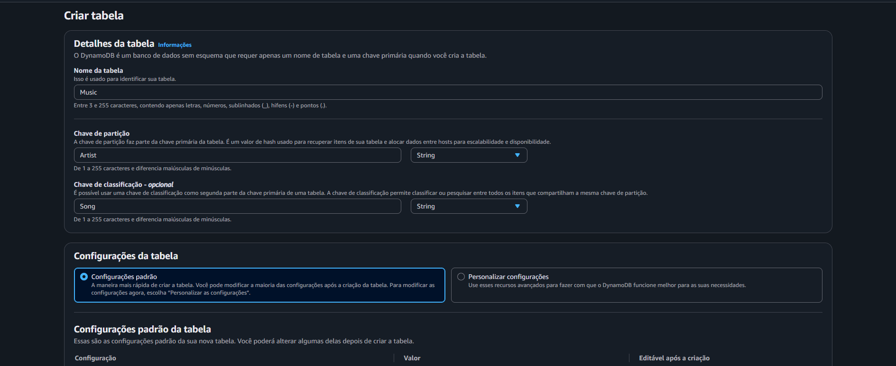
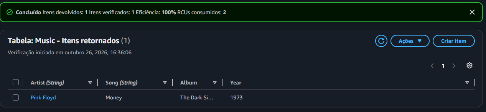
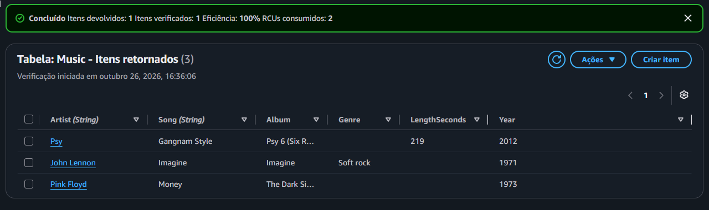
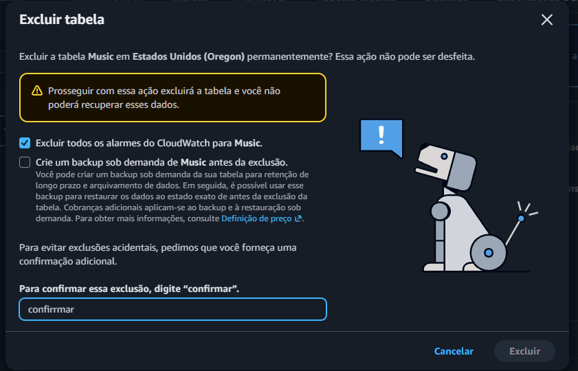

# ⚡ AWS re/Start — Introdução ao Amazon DynamoDB

Laboratório prático do programa **AWS re/Start** em que usei o **Amazon DynamoDB**, o banco de dados **NoSQL** gerenciado da AWS: criei uma tabela para uma **biblioteca de música**, inseri e editei itens, fiz **consultas (Query)** e **verificações (Scan)** e, no fim, **excluí a tabela**.

---

## 🎯 Objetivos do laboratório

- **Criar** uma tabela do DynamoDB
- **Inserir** dados
- **Consultar** a tabela
- **Excluir** a tabela

## 🧠 O que é o DynamoDB

Um serviço de banco de dados **NoSQL** rápido e flexível, **totalmente gerenciado**, que entrega **latência de milissegundos** em qualquer escala. Suporta os modelos de **chave-valor** e de **documento**, e é muito usado em aplicativos web e móveis, jogos, IoT e tecnologia de anúncios.

### Vocabulário do DynamoDB (comparado ao SQL)

| DynamoDB | Equivalente no mundo relacional | Observação |
|---|---|---|
| **Tabela** | Tabela | Coleção de dados sobre um tópico |
| **Item** | Linha | Grupo de atributos identificável de forma única |
| **Atributo** | Coluna | Elemento básico de dado, **mas cada item pode ter atributos diferentes** |
| **Chave de partição** | (parte da chave primária) | Distribui os dados entre os servidores |
| **Chave de classificação** | (parte da chave primária) | Opcional; ordena os itens dentro da mesma partição |

> A combinação de **chave de partição + chave de classificação** identifica **cada item de forma única**.

---

## 🧩 O que eu fiz

### Tarefa 1: Criar a tabela
Em **DynamoDB → Create table**:

| Campo | Valor |
|---|---|
| Nome da tabela | `Music` |
| Chave de partição | `Artist` (String) |
| Chave de classificação | `Song` (String) |
| Demais configurações | Padrão |

Aguardei a tabela ficar **Active** (ativa), o que levou menos de um minuto.

### Tarefa 2: Adicionar dados
Em **Actions → Create item**, criei três itens. Só **`Artist`** e **`Song`** (as chaves) são obrigatórios. Os demais atributos são livres:

| Artist | Song | Album | Year | Extra |
|---|---|---|---|---|
| Pink Floyd | Money | The Dark Side of the Moon | 1973 | — |
| John Lennon | Imagine | Imagine | 1971 | `Genre` = Soft rock |
| Psy | Gangnam Style | Psy 6 (Six Rules), Part 1 | 2011 | `LengthSeconds` = 219 |

> **Lição:** o segundo item tem o atributo **`Genre`** e o terceiro tem o **`LengthSeconds`**, que os outros não têm. Isso mostra a **flexibilidade** do modelo: **não é preciso definir um esquema** antes, além das chaves.

### Tarefa 3: Modificar um item
Para corrigir um erro nos dados, abri **Explore items → Music**, selecionei o item de **Psy** e mudei o **`Year`** de **2011** para **2012**, salvando com **Save changes**.

### Tarefa 4: Consultar a tabela

**Query (consulta)**, usando a chave primária:

| Campo | Valor |
|---|---|
| Artist (chave de partição) | `Psy` |
| Song (chave de classificação) | `Gangnam Style` |

A música apareceu **rapidamente**. ✅

**Scan (verificação)**, com um filtro:

| Campo | Valor |
|---|---|
| Nome do atributo | `Year` |
| Tipo | Number |
| Valor | `1971` |

Apareceu **apenas a música lançada em 1971** (*Imagine*).

### Query x Scan

| | **Query** | **Scan** |
|---|---|---|
| Como busca | Pela **chave primária** (partição e, opcionalmente, classificação) | **Percorre todos os itens** da tabela |
| Eficiência | **Muito eficiente** (usa o índice) | **Menos eficiente** e mais lento em tabelas grandes |
| Quando usar | **Sempre que possível** | Quando não dá para usar a chave |

> 💡 No Scan, o **filtro só reduz o que é mostrado**: a leitura passa por **todos os itens** antes de filtrar. Por isso, em tabelas grandes, o Scan é mais caro e mais demorado.

### Tarefa 5: Excluir a tabela
Em **Tables → Music → Actions → Delete table**, confirmei a exclusão digitando a palavra de confirmação pedida pelo console. A tabela e **todos os dados** foram removidos.

> ⚠️ A exclusão é **permanente**. O console oferece, ainda, a opção de **criar um backup sob demanda antes de excluir** (que pode gerar cobrança) e a de **excluir os alarmes do CloudWatch** associados à tabela.

---

## 💡 O que eu aprendi

- **NoSQL x relacional:** nos labs de SQL, a estrutura da tabela era **definida antes** (`CREATE TABLE`) e todas as linhas tinham as **mesmas colunas**. No DynamoDB, só a **chave** é obrigatória, e cada item pode ter **atributos diferentes**
- **A escolha da chave é a decisão de modelagem mais importante**, porque define como os dados são **distribuídos** e **buscados** com eficiência
- **Query é a forma recomendada** de ler dados, enquanto o **Scan** deve ser evitado em tabelas grandes
- É um serviço **gerenciado**: não há servidor para instalar, atualizar ou aplicar patches
- Dá para carregar dados mais rápido pela **AWS CLI**, **programaticamente** (SDKs) ou com ferramentas dedicadas, em vez de criar item por item no console

## ✅ Boas práticas que levo daqui

- **Pensar nas consultas antes de escolher as chaves**
- **Preferir `Query` a `Scan`**
- **Usar atributos opcionais** com cuidado, mantendo padrões para facilitar a manutenção
- **Fazer backup** antes de excluir dados importantes
- **Excluir recursos que não estão em uso** para evitar cobranças
- **Encerrar o laboratório** ao final para liberar os recursos

---

## 📸 Evidências

## 👤 Autor

**Werther Crisley**
🔗 [GitHub](https://github.com/WertherCrisley)