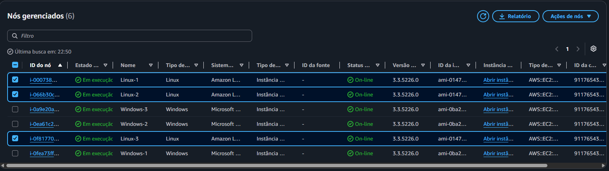
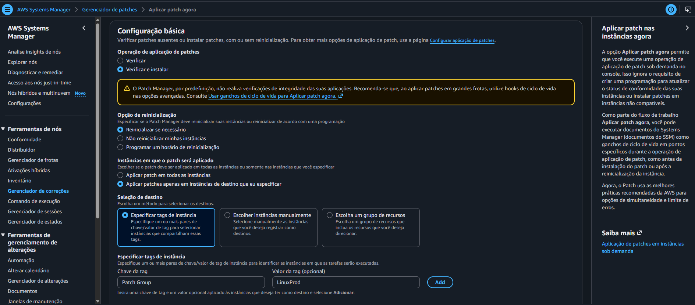
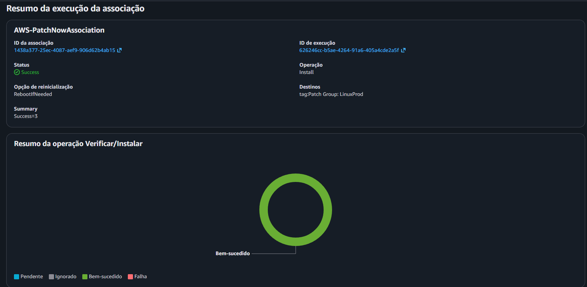

# 🩹 AWS re/Start — Fortalecimento de Sistemas com o Patch Manager (AWS Systems Manager)

Laboratório prático do programa **AWS re/Start** em que usei o **Patch Manager**, um recurso do **AWS Systems Manager**, para **aplicar patches de segurança** em um conjunto de instâncias EC2 **Linux e Windows**, usando uma **lista de referência (baseline) padrão** e outra **personalizada**, e depois **verificar a conformidade** de toda a frota.

---

## 🎯 Objetivos do laboratório

- Aplicar patches a instâncias **Linux** usando a lista de referência **padrão**
- Criar uma lista de referência de patches **personalizada**
- Usar **grupos de patches** para aplicar patches a instâncias **Windows** com a lista personalizada
- **Verificar a conformidade** dos patches

## 📩 O cenário

Em organizações com **centenas ou milhares de máquinas**, manter sistema operacional e software atualizados é um desafio logístico. É preciso ter uma **política de segurança clara** e um plano para garantir que todas as máquinas rodem, no mínimo, uma versão definida. O Patch Manager automatiza esse trabalho.

**Ambiente do lab:** 6 instâncias EC2, sendo **3 com Linux** (tag `LinuxProd`) e **3 com Windows**, já com os perfis do IAM necessários para o Systems Manager gerenciá-las.

---

## 🧠 Conceitos principais

| Conceito | O que é |
|---|---|
| **Patch Manager** | Recurso do Systems Manager que automatiza a aplicação de patches |
| **Lista de referência de patches (*baseline*)** | Define **quais patches são aprovados ou rejeitados** |
| **Baseline padrão** | Pré-definida pela AWS para cada SO, usada **como está** (não dá para editar) |
| **Baseline personalizada** | Criada por mim, com regras de aprovação sob medida |
| **Grupo de patches** | Conjunto de instâncias, identificado pela **tag `Patch Group`**, associado a uma baseline |
| **Regra de aprovação** | Produto, severidade, classificação e prazo de aprovação automática |
| **Run Command / documento SSM** | Mecanismo que executa o patch nas instâncias (`RunPatchBaseline`) |

---

## 🧩 O que eu fiz

### Tarefa 1: Patches nas instâncias Linux (baseline padrão)
1. No **Systems Manager → Fleet Manager**, vi as 6 instâncias gerenciadas (elas aparecem ali por terem o **perfil do IAM** correto)
2. Em **Patch Manager**, escolhi **Aplicar patch agora** com a baseline padrão do Amazon Linux 2 (`AWS-AmazonLinux2DefaultPatchBaseline`)
3. Configurei:

| Opção | Valor |
|---|---|
| Operação de patch | **Verificar e instalar** |
| Reinicialização | **Reinicializar se necessário** |
| Instâncias | Apenas as de destino que eu especificar |
| Seleção de destino | Tag de instância |
| Chave / valor da tag | `Patch Group` / `LinuxProd` |

4. Acompanhei o progresso até as **3 instâncias** concluírem

### Tarefa 2: Criar uma baseline personalizada para o Windows
Em **Patch Manager → Lista de referência de patches → Criar**:

| Campo | Valor |
|---|---|
| Nome | `WindowsServerSecurityUpdates` |
| Descrição | `Windows security baseline patch` |
| Sistema operacional | Windows |
| Baseline padrão | **Não** marcada |

**Duas regras de aprovação**, ambas para `WindowsServer2019` e classificação `SecurityUpdates`:

| | Severidade | Aprovação automática | Relatório de conformidade |
|---|---|---|---|
| **Regra 1** | Crítica | 3 dias | Crítica |
| **Regra 2** | Importante | 3 dias | Alta |

Depois, associei a baseline ao grupo de patches **`WindowsProd`** (*Ações → Modificar grupos de patches*).

### Tarefa 3: Patches nas instâncias Windows
1. No EC2, **marquei** `Windows-1`, `Windows-2` e `Windows-3` com a tag **`Patch Group` = `WindowsProd`**
2. No Patch Manager, **Aplicar patch agora** (verificar e instalar, reinicializar se necessário), com destino na tag `Patch Group` = `WindowsProd`
3. Abri o **ID de execução** e, em uma instância *InProgress*, o link **Saída** para ver os detalhes no **Run Command**, incluindo o `PatchGroup: WindowsProd`

> Por trás, o Patch Manager usa o **Run Command** para executar o documento **`RunPatchBaseline`**, que avalia quais patches instalar de acordo com o SO de cada instância.

### Tarefa 4: Verificar a conformidade
1. No **Painel** do Patch Manager, o **Resumo da conformidade** mostrou as **6 instâncias compatíveis** (Linux e Windows) ✅
2. Em **Relatórios de conformidade**, conferi o status de cada instância e as colunas de **contagem não compatível** (crítica, segurança e outras), **data da última operação** e **ID da baseline**
3. Abri o ID de um nó Windows → aba **Patch** para ver **quais patches foram aplicados** e **quando**

---

## 💡 O que eu aprendi

- **Baseline** é a "política" de patches: **o que** é aprovado e **depois de quanto tempo**
- **Tags + grupos de patches** permitem **segmentar** a frota (por exemplo, produção Linux x produção Windows) com baselines diferentes
- **Aprovação automática com atraso** (aqui, 3 dias) dá tempo para a comunidade identificar patches problemáticos antes de instalar
- O **"Aplicar patch agora"** é para ações pontuais. Para rotina, o caminho é usar uma **janela de manutenção** agendada
- A **conformidade** mostra, em um só lugar, se a frota inteira está em dia
- Um **perfil do IAM** na instância é o que permite o Systems Manager gerenciá-la

> ⚠️ **Atenção em produção:** a opção "reinicializar se necessário" **pode reiniciar a instância**. Em ambientes reais, isso deve ser feito em **janelas de manutenção** planejadas, para evitar indisponibilidade.

## ✅ Boas práticas que levo daqui

- **Ter uma política de patches clara** e aplicá-la de forma automatizada
- **Segmentar instâncias por grupos de patches** (tags)
- **Testar patches** antes de levá-los à produção
- **Agendar** a aplicação em janelas de manutenção
- **Monitorar a conformidade** regularmente
- **Encerrar o laboratório** ao final para liberar os recursos

---

## 📸 Evidências

---

## 📚 Próximos passos

- Criar uma **janela de manutenção** para aplicar patches automaticamente
- Explorar o **State Manager** e os **documentos SSM**
- Usar o **Session Manager** para acessar instâncias sem SSH aberto
- Configurar **alertas** quando houver instâncias não compatíveis
- Documentar os próximos labs do re/Start neste repositório

---

## 👤 Autor

**Werther Crisley**
🔗 [GitHub](https://github.com/WertherCrisley)