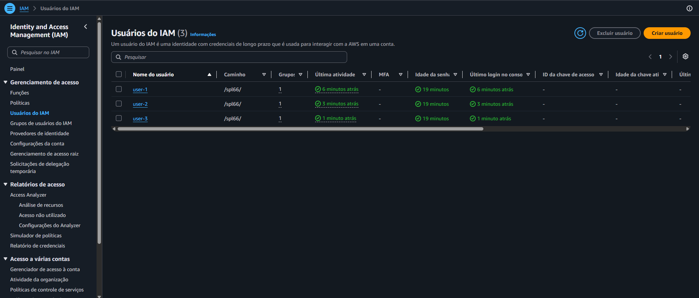
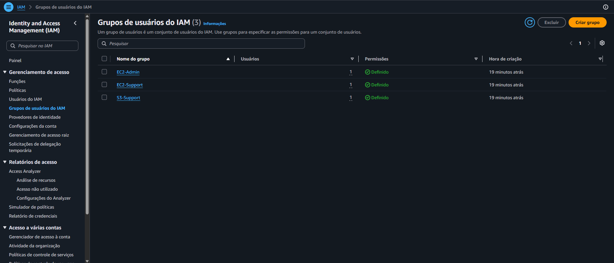
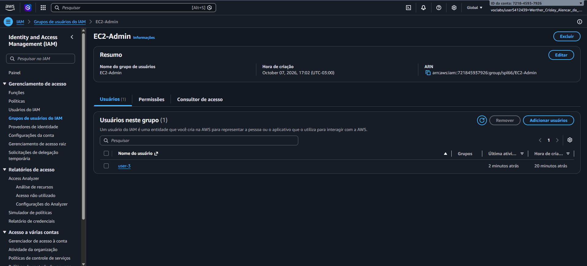

# 🔑 AWS re/Start — Introdução ao AWS IAM (Usuários, Grupos e Políticas)

Laboratório prático do programa **AWS re/Start** em que explorei o **AWS Identity and Access Management (IAM)**: criei uma **política de senhas**, analisei **usuários, grupos e políticas**, organizei os usuários em grupos conforme a função de cada um e **testei na prática** como as permissões mudam o que cada pessoa consegue fazer.

---

## 🎯 Objetivos do laboratório

- Criar e aplicar uma **política de senhas** do IAM
- Explorar **usuários e grupos** pré-criados
- Inspecionar as **políticas** aplicadas aos grupos
- **Adicionar usuários a grupos** com permissões específicas
- Localizar e usar o **URL de login do IAM**
- **Testar os efeitos** das políticas sobre o acesso aos serviços

## 🧠 Para que serve o IAM

| Recurso | Função |
|---|---|
| **Usuários** | Pessoas ou aplicações com credenciais individuais (senhas, chaves de acesso, MFA) |
| **Grupos de usuários** | Conjuntos de usuários que recebem as **mesmas permissões** |
| **Políticas** | Documentos que definem o que é **permitido ou negado** |
| **Perfis (*roles*)** | Identidades com permissões que podem ser **assumidas** por quem precisar, em vez de ligadas a uma pessoa só |
| **Federação** | Permite que usuários já existentes na empresa acessem a AWS **sem criar um usuário IAM para cada um** |

---

## 🧩 O que eu fiz

### Tarefa 1: Política de senhas da conta
Em **IAM → Account settings → Change password policy**, reforcei os requisitos:

| Opção | Valor |
|---|---|
| Comprimento mínimo | **10 caracteres** (antes, 8) |
| Requisitos de complexidade | Todas as caixas marcadas, **exceto** "expiração exige redefinição pelo administrador" |
| Expiração da senha | **90 dias** (padrão mantido) |
| Impedir reutilização | **5 senhas** (padrão mantido) |

> A política vale para **toda a conta**, afetando todos os usuários IAM.

### Tarefa 2: Explorar usuários, grupos e políticas

**Usuários pré-criados:** `user-1`, `user-2` e `user-3`, todos **sem permissões** e **sem grupos** no início, mas com senha de acesso ao console.

**Grupos e suas políticas:**

| Grupo | Política | Tipo | O que permite |
|---|---|---|---|
| `S3-Support` | `AmazonS3ReadOnlyAccess` | Gerenciada | Listar e ler recursos do **S3** |
| `EC2-Support` | `AmazonEC2ReadOnlyAccess` | Gerenciada | **Visualizar** EC2, ELB, CloudWatch e Auto Scaling, sem alterar |
| `EC2-Admin` | `EC2-Admin-Policy` | ***Inline*** (do cliente) | **Visualizar**, **iniciar** e **interromper** instâncias EC2 |

**Estrutura de uma política IAM:**

| Elemento | Significado |
|---|---|
| **Effect** | `Allow` (permitir) ou `Deny` (negar) |
| **Action** | As chamadas de API permitidas (ex.: `cloudwatch:ListMetrics`) |
| **Resource** | A que recursos se aplica (um bucket, uma instância, ou `*` para todos) |

**Política gerenciada x inline:**
- **Gerenciada:** predefinida (pela AWS ou por administradores), **reutilizável**; quando é atualizada, a mudança vale **para todos** os que a usam
- **Inline:** vinculada a **um único** usuário ou grupo; usada em situações pontuais

### Tarefa 3: Colocar cada usuário no grupo certo

| Usuário | Grupo | Permissão resultante |
|---|---|---|
| `user-1` | `S3-Support` | Somente leitura no S3 |
| `user-2` | `EC2-Support` | Somente leitura no EC2 |
| `user-3` | `EC2-Admin` | Ver, iniciar e interromper instâncias EC2 |

Conferi em **User groups** que cada grupo ficou com **1 usuário**.

### Tarefa 4: Testar fazendo login com cada usuário
1. Copiei o **URL de login do IAM** do painel (formato `https://<id-da-conta>.signin.aws.amazon.com/console`)
2. Abri uma **janela privada/anônima** para não misturar as sessões
3. Entrei com cada usuário e testei os serviços:

| Usuário | S3 | EC2: ver instâncias | EC2: interromper instância |
|---|---|---|---|
| `user-1` | ✅ Consegue ver os buckets | ❌ Sem autorização | — |
| `user-2` | ❌ Sem permissão para listar buckets | ✅ Consegue ver | ❌ Falha ao interromper |
| `user-3` | — | ✅ Consegue ver | ✅ **Consegue interromper** |

---

## 💡 O que eu aprendi

- **Permissões por grupo, não por pessoa:** dá mais **controle e menos trabalho** do que configurar usuário por usuário
- **Por padrão, tudo é negado:** um usuário sem políticas **não consegue fazer nada** até receber permissão (*princípio do menor privilégio*)
- **"Somente leitura" é diferente de "administrador":** o `user-2` via as instâncias, mas **não conseguia alterá-las**
- **O erro de autorização é o comportamento esperado**, não um defeito: mostra que a política está funcionando
- **Política de senhas forte** (tamanho, complexidade, expiração e não reutilização) dificulta que senhas sejam descobertas
- **Testar com cada identidade** é a forma mais confiável de validar permissões

> 🔐 **Sobre credenciais:** as senhas dos usuários de teste do lab são só do ambiente de laboratório, mas, por boa prática, **não as incluí** neste README.

## ✅ Boas práticas que levo daqui

- **Conceder o mínimo necessário** de permissão para cada função
- **Usar grupos** para organizar permissões
- **Preferir políticas gerenciadas** quando possível, e *inline* só para casos pontuais
- **Aplicar uma política de senhas robusta**
- **Testar as permissões** com cada tipo de usuário
- **Usar janelas privadas** para alternar entre identidades sem conflito
- **Encerrar o laboratório** ao final para liberar os recursos

---

## 📸 Evidências

## 📚 Próximos passos

- Ativar **MFA** (autenticação multifator) para os usuários
- Estudar **perfis (*roles*)** e como aplicações e serviços os assumem
- Ler e **escrever uma política JSON** própria
- Explorar o **IAM Access Analyzer** e as **permissões efetivas**
- Documentar os próximos labs do re/Start neste repositório

---

## 👤 Autor

**Werther Crisley**
🔗 [GitHub](https://github.com/WertherCrisley)