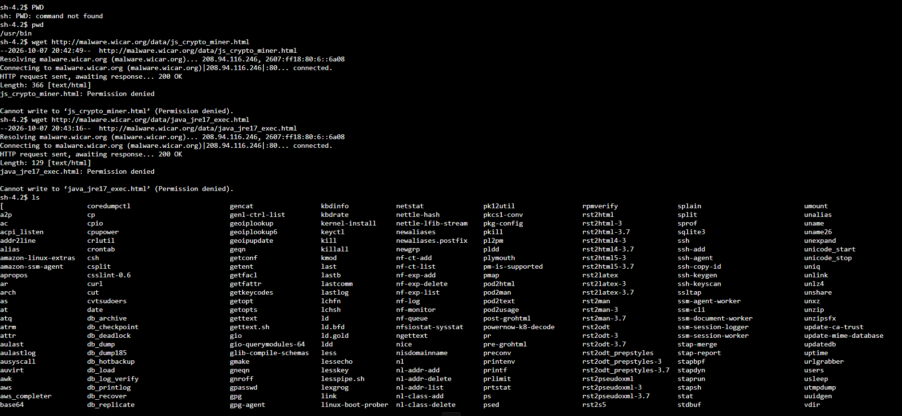

# 🧱 AWS re/Start — Proteção contra Malware com o AWS Network Firewall

Laboratório prático do programa **AWS re/Start** em que atuei como **engenheiro de segurança**: usei o **AWS Network Firewall** para **bloquear o acesso a sites que hospedam malware**, criando um **grupo de regras com Suricata**, anexando-o à **política do firewall** e validando o bloqueio a partir de uma instância de teste.


---

## 🎯 Objetivos do laboratório

- **Atualizar** um firewall de rede
- Criar um **grupo de regras** de firewall
- **Verificar e testar** se o acesso aos sites maliciosos foi bloqueado

## 📩 O cenário

Uma empresa fictícia contratou um novo engenheiro de segurança para **reforçar o perímetro da rede**. Usuários já haviam **baixado malware sem querer** ao acessar certos sites. A equipe de TI forneceu os **URLs dos sites que hospedam o malware**, e a missão era **impedir o acesso a esses arquivos**.

**Ambiente do lab:** uma instância **`TestInstance`** (EC2) numa zona de perímetro, usada para simular o usuário final, e um firewall **`LabFirewall`** já criado, com a política **`LabFirewallPolicy`**.

> ⚠️ Os arquivos usados no lab são **arquivos de teste feitos para validar soluções anti-malware**, usados num **ambiente protegido**. Não devem ser usados fora dele.

---

## 🧠 Conceitos principais

| Conceito | O que é |
|---|---|
| **Malware** | Software malicioso: vírus, worms, trojans, spyware, adware, ransomware etc. |
| **Firewall** | Barreira entre a rede interna e redes externas (como a internet) que filtra o tráfego |
| **AWS Network Firewall** | Firewall gerenciado, no nível da **VPC**, para filtrar e inspecionar tráfego de rede |
| **Política de firewall** | Define o comportamento do firewall: quais grupos de regras (*stateless* e *stateful*) usar e as ações padrão |
| **Grupo de regras** | Conjunto **reutilizável** de critérios de inspeção, adicionado a uma política |
| **Suricata** | IPS (sistema de prevenção de intrusões) de código aberto, com uma linguagem padrão de regras |

### Stateless x Stateful

| | **Stateless** | **Stateful** |
|---|---|---|
| Analisa | Cada pacote **isoladamente** | Os pacotes **no contexto do fluxo** (direção, conexão existente) |
| Complexidade das regras | Simples | **Mais complexas** (inspeção profunda) |
| Velocidade | **Mais rápida** | Pode adicionar atraso |
| Uso aqui | Encaminhar para o stateful | **Bloquear URLs maliciosos** |

---

## 🧩 O que eu fiz

### Tarefa 1: Confirmar que o malware era acessível
1. Conectei à **`TestInstance`** pelo **Session Manager** (Systems Manager), sem SSH
2. Usei o `wget` para **simular o download** dos dois arquivos de teste, como um usuário faria pelo navegador
3. Conferi com `ls` que os arquivos **foram baixados**

> **Conclusão:** o firewall atual **não bloqueava** esses endereços, e o problema estava confirmado.

### Tarefa 2: Inspecionar o firewall e ajustar a política
Em **VPC → Network Firewall → Firewalls → `LabFirewall` → `LabFirewallPolicy`**, editei as **ações padrão stateless**:

| Opção | Valor |
|---|---|
| Pacotes fragmentados | Usar as mesmas ações para todos os pacotes |
| Ação | **Forward to stateful rule groups** (encaminhar para regras stateful) |

Assim, **todo o tráfego passa por inspeção detalhada** nas regras stateful.

### Tarefa 3: Criar o grupo de regras stateful

| Campo | Valor |
|---|---|
| Tipo | **Stateful rule group** |
| Nome | `StatefulRuleGroup` |
| Capacidade | `100` |
| Formato das regras | **Suricata compatible IPS rules** |

**Regras (uma para cada arquivo malicioso):**

```suricata
drop http $HOME_NET any -> $EXTERNAL_NET 80 (msg:"MALWARE custom solution"; flow: to_server,established; classtype:trojan-activity; sid:2002001; content:"/data/js_crypto_miner.html"; http_uri; rev:1;)

drop http $HOME_NET any -> $EXTERNAL_NET 80 (msg:"MALWARE custom solution"; flow: to_server,established; classtype:trojan-activity; sid:2002002; content:"/data/java_jre17_exec.html"; http_uri; rev:1;)
```

**Como ler a regra:**

| Parte | Significado |
|---|---|
| `drop` | **Descarta** o tráfego que combinar |
| `http` | Protocolo inspecionado |
| `$HOME_NET any -> $EXTERNAL_NET 80` | De **dentro da VPC** (qualquer porta) para **fora**, na **porta 80** |
| `msg` | Mensagem que identifica a regra nos registros |
| `flow: to_server,established` | Apenas em conexões **já estabelecidas**, no sentido **cliente → servidor** |
| `classtype:trojan-activity` | Classificação da ameaça |
| `sid` | Identificador **único** da regra |
| `content:"..."; http_uri` | Procura esse **caminho** na URI da requisição HTTP |
| `rev` | Revisão da regra |

### Tarefa 4: Anexar o grupo de regras
No `LabFirewall`, em **Add rule groups → Add from existing stateful rule groups**, selecionei o `StatefulRuleGroup`. O console confirmou que a **política de firewall foi atualizada**, e o grupo apareceu na seção de grupos stateful.

> Na prática, o grupo de regras fica associado à **política**, e é a política que o firewall aplica.

### Tarefa 5: Validar a solução
Voltei à `TestInstance` (Session Manager) e repeti o `wget` nos dois arquivos de teste:

- A saída **parou em** `HTTP request sent, awaiting response...`, sem baixar o arquivo, o que mostra que o tráfego foi **bloqueado** ✅
- Interrompi com **`Ctrl+C`**
- Limpei os arquivos de teste com `rm` e confirmei com `ls` que a pasta ficou **vazia**

> **Por que ficou "esperando"?** A ação `drop` **descarta** os pacotes **sem avisar** o cliente, então a conexão não recebe resposta e fica aguardando até estourar o tempo.

---

## 💡 O que eu aprendi

- **Firewall de rede** protege o perímetro **antes** de o tráfego chegar aos usuários e servidores
- A **política** é o "cérebro" que organiza os grupos de regras, enquanto o **grupo de regras** contém os critérios
- **Regras Suricata** permitem **inspecionar o conteúdo** das requisições (como o caminho da URL), indo além de só liberar ou bloquear portas
- **Testar antes e depois** (baseline x correção) comprova que a solução funcionou
- O bloqueio **não depende dos usuários**: ele protege mesmo quando alguém clica sem querer
- Cada regra precisa de um **`sid` único**

> ⚠️ **Limitações desta solução:** as regras bloqueiam **caminhos específicos em HTTP (porta 80)**, ou seja, tráfego sem criptografia. Para **HTTPS**, o conteúdo da URL não é visível sem inspeção TLS, então o caminho é usar **listas de domínios** (que inspecionam o nome do site) ou outras camadas de defesa. E bloquear **uma lista fixa de URLs** não cobre malware novo.

## ✅ Boas práticas que levo daqui

- **Defesa em camadas**: firewall, antivírus, controle de acesso e treinamento dos usuários
- **Testar o bloqueio** a partir da perspectiva do usuário
- **Usar `sid` únicos** e mensagens claras nas regras, para facilitar os logs
- **Limpar arquivos de teste** ao final
- **Manter as listas de ameaças atualizadas**
- **Usar arquivos de teste** (e não malware real) para validar defesas
- **Encerrar o laboratório** ao final para liberar os recursos

---

## 📸 Evidências




## 👤 Autor

**Werther Crisley**
🔗 [GitHub](https://github.com/WertherCrisley)