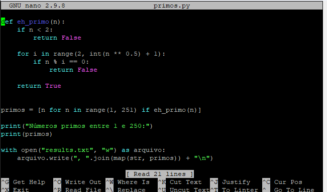
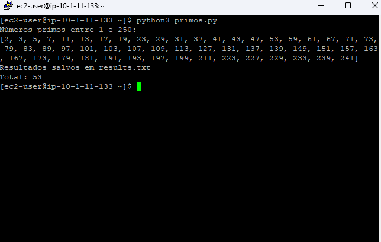

# 🔢 AWS re/Start — Desafio de Python: Números Primos de 1 a 250

Laboratório de **desafio** do programa **AWS re/Start** em que, conectado por **SSH** a uma instância **Amazon Linux (EC2)**, escrevi um **script em Python** que encontra todos os **números primos entre 1 e 250**, mostra o resultado na tela e o **grava em um arquivo `results.txt`**.


---

## 🎯 O desafio

Escrever um script Python que:

1. **Exiba** todos os números primos de 1 a 250
2. **Armazene** os resultados em um arquivo `results.txt`
3. Seja **testado**, verificando que o `results.txt` tem o resultado esperado
4. Seja **salvo**, anotando o seu **caminho absoluto** para referência futura

> **Lembrete:** um número **primo** é maior que 1 e só é divisível por **1 e por ele mesmo**. O **1 não é primo**, e o **2 é o único primo par**.

---

## 💻 O script (`primos.py`)

```python
#!/usr/bin/env python3
"""Exibe os números primos de 1 a 250 e grava o resultado em results.txt."""

import os

LIMITE = 250


def eh_primo(n):
    """Retorna True se n for primo."""
    if n < 2:
        return False
    # basta testar divisores até a raiz quadrada de n
    divisor = 2
    while divisor * divisor <= n:
        if n % divisor == 0:
            return False
        divisor += 1
    return True


primos = [n for n in range(1, LIMITE + 1) if eh_primo(n)]

# Mostra na tela
print(f"Números primos de 1 a {LIMITE}:")
print(*primos)
print(f"Total: {len(primos)}")

# Grava no results.txt, na mesma pasta do script
pasta = os.path.dirname(os.path.abspath(__file__))
arquivo = os.path.join(pasta, "results.txt")
with open(arquivo, "w") as f:
    for p in primos:
        f.write(f"{p}\n")

print(f"Resultado salvo em: {arquivo}")
```

### Como executar

```bash
python3 primos.py
cat results.txt      # confere o conteúdo gravado
wc -l results.txt    # conta as linhas
pwd                  # mostra o caminho absoluto da pasta do script
```

### Resultado

Testei o script e ele encontrou **53 números primos**, do **2** até o **241**:

```
2 3 5 7 11 13 17 19 23 29 31 37 41 43 47 53 59 61 67 71 73 79 83 89 97
101 103 107 109 113 127 131 137 139 149 151 157 163 167 173 179 181 191
193 197 199 211 223 227 229 233 239 241
```

Para validar, comparei o `results.txt` com o resultado de **outro método** (o crivo de Eratóstenes), e os dois bateram ✅.

---

## 🔍 Como o script funciona

| Parte | O que faz |
|---|---|
| `LIMITE = 250` | Guarda o limite em uma constante, fácil de mudar |
| `eh_primo(n)` | Função que decide se `n` é primo |
| `if n < 2` | Descarta 0, 1 e negativos, que não são primos |
| `while divisor * divisor <= n` | Testa divisores **só até a raiz quadrada** de `n` |
| `n % divisor == 0` | Se o resto da divisão é 0, achou um divisor: **não é primo** |
| `[n for n in range(...) if eh_primo(n)]` | *List comprehension*: monta a lista com os números que passam no teste |
| `print(*primos)` | Imprime a lista com os valores separados por espaço |
| `os.path.abspath(__file__)` | Descobre o caminho **absoluto** do script |
| `with open(...) as f` | Abre o arquivo e **garante que ele será fechado** no final |

### Por que testar só até a raiz quadrada?
Se `n` tem um divisor maior que a sua raiz quadrada, ele também tem um **menor**. Então, se nenhum divisor até a raiz foi encontrado, não há divisores. Isso torna o script **bem mais rápido** do que testar todos os números anteriores.

---

## 🧠 O que eu aprendi

- **Dividir o problema em partes:** uma função para **decidir** (`eh_primo`) e outro trecho para **mostrar e salvar**
- **Laços e condições** (`while`, `if`) e o operador **resto da divisão** (`%`)
- **List comprehension** para construir listas de forma compacta
- **Ler e escrever arquivos** com `open()` no modo `"w"` e o bloco `with`
- **f-strings** (`f"{p}\n"`) para formatar texto
- Como **obter o caminho absoluto** do próprio script
- **Validar o resultado com um método independente**, e não só olhar se "parece certo"
- Pensar em **eficiência**: testar até a raiz quadrada já economiza muito trabalho

> ⚠️ O modo `"w"` **sobrescreve** o arquivo se ele já existir. Para **acrescentar** ao final, o modo seria `"a"`.

## ✅ Boas práticas que levo daqui

- **Nomear funções e variáveis** de forma clara
- **Documentar** com *docstrings* e comentários
- **Separar a lógica** (função) do **resultado** (impressão e arquivo)
- **Testar** o script e **conferir a saída**
- **Anotar onde o script foi salvo** (caminho absoluto)
- **Encerrar o laboratório** ao final (os recursos do lab ficam preservados para a próxima vez)

---

## 📸 Evidências






## 👤 Autor

**Werther Crisley**
🔗 [GitHub](https://github.com/WertherCrisley)