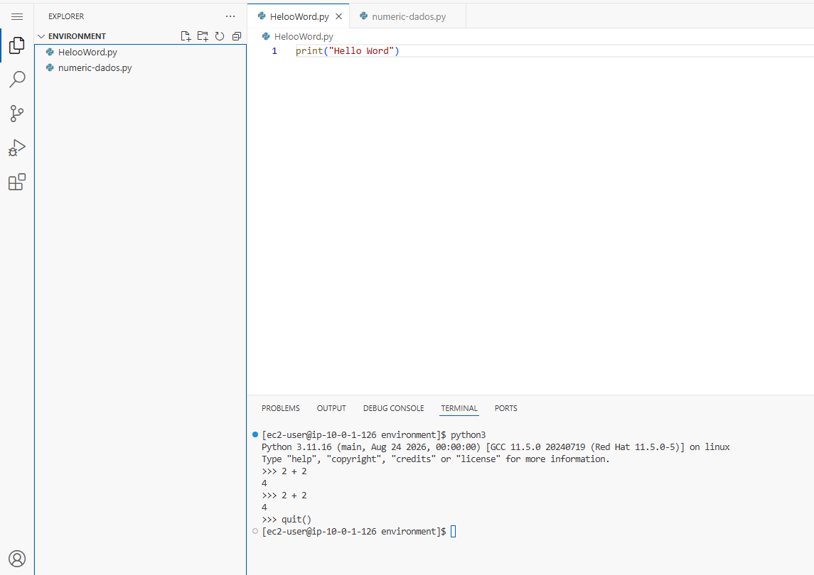

# 🧮 AWS re/Start — Usando o Python Shell

Exercício do programa **AWS re/Start** (módulo de **Introdução à Programação**) em que usei o **Python shell**, o modo interativo do Python, para testar operações matemáticas básicas direto no terminal.


---

## 🎯 Objetivo

Aprender a abrir o **Python shell**, executar comandos de **soma, subtração, multiplicação e divisão** e sair dele.

## 🧠 O que é o Python shell

O **shell interativo** (também chamado de **REPL**) executa **uma instrução por vez** e mostra o resultado **na hora**. É ótimo para **testar ideias rápido** sem precisar criar um arquivo `.py`.

O símbolo **`>>>`** é o *prompt*: indica que o Python está esperando um comando.

---

## 🧩 O que eu fiz

### Abrir o shell
```bash
python3
```

O Python mostra a versão e o prompt `>>>`:

```
Python 3.11 ...
Type "help", "copyright", "credits" or "license" for more information.
>>>
```

### As quatro operações

| Operação | Símbolo | Entrada | Resultado |
|---|---|---|---|
| **Adição** | `+` | `2 + 2` | `4` |
| **Subtração** | `-` | `4 - 2` | `2` |
| **Multiplicação** | `*` | `2 * 2` | `4` |
| **Divisão** | `/` | `4 / 2` | `2.0` |

Em cada uma, digitei a expressão e apertei **ENTER** para ver o resultado.

### Sair do shell
```python
quit()
```

---

## 💡 O que eu aprendi

- O Python pode ser usado como uma **calculadora interativa**
- O resultado de cada expressão aparece **imediatamente**, sem precisar de `print()`
- Cada operação tem seu símbolo: `+`, `-`, `*` e `/`
- **A divisão (`/`) sempre retorna um número decimal** (*float*) no Python 3: `4 / 2` dá **`2.0`**, e não `2`
- Para **sair** do shell, uso **`quit()`**

> 💡 **Shell x script:** no shell, o resultado aparece sozinho. Em um arquivo `.py`, preciso usar `print()` para mostrar algo na tela, como no programa "Hello, World".

## ✅ Boas práticas que levo daqui

- **Usar o shell para testar** pequenos trechos antes de colocá-los no código
- **Prestar atenção ao tipo do resultado** (`2` é inteiro e `2.0` é decimal)
- **Conferir a entrada digitada**, porque um símbolo trocado muda a operação

---

## 📸 Evidências



## 👤 Autor

**Werther Crisley**
🔗 [GitHub](https://github.com/WertherCrisley)