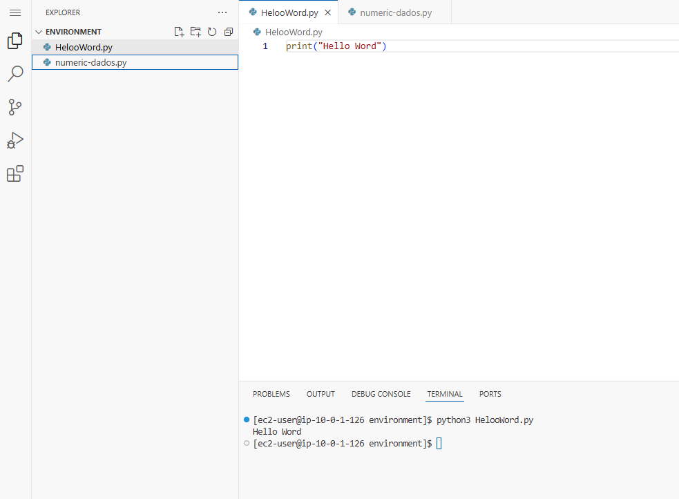

# 🐍 AWS re/Start — Meu Primeiro Programa em Python: Hello, World

Laboratório do programa **AWS re/Start** (módulo de **Introdução à Programação**) em que escrevi e executei meu **primeiro programa em Python**, usando o **VS Code** no navegador e o terminal.


---

## 🎯 Objetivo

Criar e executar um programa **"Hello, World"** em Python, verificando que o ambiente de desenvolvimento está funcionando.

## 💻 O programa

```python
print("Hello, World")
```

**Como executar:**

```bash
python3 hello-world.py
```

**Saída esperada:**

```
Hello, World
```

---

## 🧩 O que eu fiz

1. **Abri o VS Code IDE** do ambiente do lab pelo navegador
2. **Criei um arquivo novo** e o salvei como `hello-world.py` na pasta de trabalho (`/home/ec2-user/environment`)
3. **Abri um terminal** dentro do VS Code e conferi onde eu estava com `pwd`
4. **Verifiquei as versões do Python** instaladas
5. **Escrevi o código** `print("Hello, World")` e salvei
6. **Executei** o programa no terminal e confirmei a saída ✅

### Verificando as versões do Python

```bash
python --version      # versão padrão
python2 --version     # Python 2
python3 --version     # Python 3
```

No exemplo do lab, o `python` e o `python3` apontavam para o **Python 3.11**, e o `python2` retornava **`command not found`** (não está instalado).

---

## 🧠 O que eu aprendi

- **Python** é uma linguagem de **alto nível** (usa palavras em inglês e símbolos, mais próxima da linguagem humana) e de **propósito geral** (serve para aplicações desktop, sites, automação e muito mais)
- A extensão **`.py`** identifica arquivos Python
- **Python 2 x Python 3:** são versões principais **com diferenças de sintaxe** entre si. Neste curso, o foco é o **Python 3**, e por isso uso o comando `python3`
- **Compatibilidade retroativa:** em geral, o código antigo continua funcionando em versões menores novas, mas **não necessariamente entre versões principais**
- **`print()`** é a função que **mostra um texto** na tela
- O fluxo básico de programar: **escrever → salvar → executar → conferir o resultado**
- Um **IDE** (como o VS Code) reúne **editor de código, explorador de arquivos e terminal** no mesmo lugar

> 💡 Por que "Hello, World"? É a tradição para quem está aprendendo a programar: um programa mínimo que **confirma que as ferramentas estão instaladas e funcionando**.

## ✅ Boas práticas que levo daqui

- **Conferir a versão** da linguagem antes de começar
- **Salvar o arquivo** antes de executar (senão o programa roda a versão antiga)
- **Dar nomes claros** aos arquivos (`hello-world.py`)
- **Executar do diretório certo** (confirmar com `pwd`)
- **Encerrar o laboratório** ao final para liberar os recursos

---

## 📸 Evidências



## 👤 Autor

**Werther Crisley**
🔗 [GitHub](https://github.com/WertherCrisley)